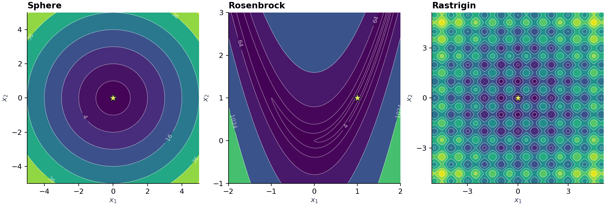
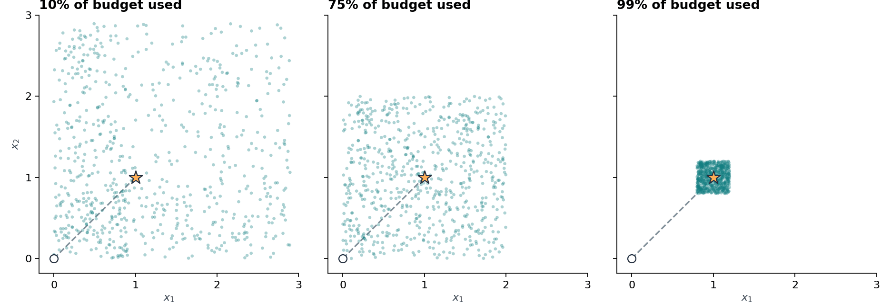

# Farthest Better or Nearest Worse Optimizer (FNO)

FNO is a population-based optimizer for bounded minimization. Each agent uses two neighbors to propose its next move. The nearest worse agent helps it step away from a poorer region. The farthest better agent gives it a promising region to explore. An agent accepts a move only when its objective value improves. [Paper in *Artificial Intelligence Review*](https://doi.org/10.1007/s10462-025-11443-z)

## Two-dimensional test functions



Each panel shows objective values on the search domain used in the example. Darker regions have lower cost. The orange star marks the global minimum, where the cost is zero.

| Function | Objective | Minimizer | Landscape |
| --- | --- | --- | --- |
| Sphere | $x_1^2+x_2^2$ | $(0,0)$ | A smooth bowl with circular contours |
| Rosenbrock | $(1-x_1)^2+100(x_2-x_1^2)^2$ | $(1,1)$ | A narrow, curved valley |
| Rastrigin | $20+\sum_{j=1}^2[x_j^2-10\cos(2\pi x_j)]$ | $(0,0)$ | A grid of local minima around the global minimum |

Run all three from the repository root in MATLAB. Each run uses 30 agents and 3,000 objective evaluations.

```matlab
run('examples/benchmarks_2d.m')
```

## Dynamic Focus Strategy (DFS)

Let $p$ be the fraction of the evaluation budget used. With probability $p$, FNO takes a focus step from the temporary position $t$ toward the farthest better position $b$. For each coordinate $j$, the proposal is

$$
x_j^{\mathrm{trial}} = t_j + W d_j (b_j-t_j), \qquad
d_j = \left|\mu + (2u_j-1)\sqrt{1-p}\right|.
$$

The coordinates share a uniform draw $\mu$ and a step weight $W$, while each $u_j$ is drawn independently and uniformly from $[0,1]$. Early in the run, the coordinate multipliers can differ substantially, spreading proposals to either side of the line through $t$ and $b$. As the budget runs down, the multipliers approach the shared value $\mu$, concentrating proposals near that line. A large step can carry the agent beyond $b$.



The circle marks $t=(0,0)$ and the star marks $b=(1,1)$. Each panel shows 700 possible focus proposals with the same random draws. Fixing $W=2$ and $\mu=0.5$ isolates the effect of the shrinking focus width. With these settings the proposals converge on the star as $p$ approaches one.

## Quick start

Clone the repository and open its root folder in MATLAB. The optimizer and Sphere example use base MATLAB.

```sh
git clone https://github.com/AhmadTaheri2021/FNO-Optimizer.git
cd FNO-Optimizer
```

Minimize the five-dimensional Sphere function with 30 agents and a budget of 3,000 objective evaluations. Its known minimum is zero at the origin.

```matlab
rng(42, 'twister');
objective = @(x) sum(x.^2);
[bestCost, bestPosition, history] = fno(objective, 5, -5, 5, 30, 3000);
plot(history);
xlabel('Objective evaluations');
ylabel('Best cost so far');
```

The same optimization is available as a runnable [demo](examples/sphere_demo.m).

## Solver interface

```matlab
[bestCost, bestPosition, history] = fno(objective, nVars, lb, ub, popSize, maxEvals)
```

- `objective(x)` receives a row vector and returns one real numeric cost. Smaller values are better. Use a penalty in the objective for constraints beyond the box bounds.
- `lb` and `ub` may be scalars or vectors with one entry per variable. Equal bounds fix a coordinate.
- `popSize` must be at least two. `maxEvals` includes population initialization and must be at least `popSize`.
- `bestPosition` is a row vector. The column vector `history` records the incumbent after every evaluation, including initialization.
- To start from evaluated solutions, pass a seventh argument containing `popSize` structs with fields `Position` and `Cost`. These costs must use the same objective and count toward the budget.

## CEC2014 benchmark

For the 30-dimensional CEC2014 F2 setup, make your CEC2014 MATLAB evaluator (`cec14_func`) and its required benchmark data available, then execute `Run_FNO`. The benchmark data and evaluator are external dependencies. The runner passes column vectors to CEC2014 and reports objective error after subtracting the function bias (`100 * functionID`).

To use a pre-evaluated CEC2014 population, call:

```matlab
[history, bestCost] = FNO_final(N, MaxFEs, LB, UB, HM, nPop, functionID);
```

## Tests

From the repository root in MATLAB:

```matlab
addpath('tests');
test_fno
```

The tests check evaluation counts, incumbent history, repeatability, bounds, pre-evaluated populations, and the CEC2014 output order.

## Citation

```bibtex
@article{taheri2026fno,
  author  = {Taheri, Ahmad and RahimiZadeh, Keyvan and Baumbach, Jan and
             Beheshti, Amin and Zolotareva, Olga and Al-Betar, Mohammed Azmi and
             Mirjalili, Seyedali and Gandomi, Amir H.},
  title   = {Farthest better or nearest worse optimizer: a novel metaheuristic algorithm},
  journal = {Artificial Intelligence Review},
  year    = {2026},
  volume  = {59},
  pages   = {79},
  doi     = {10.1007/s10462-025-11443-z}
}
```

## License

The implementation is distributed under the [MIT License](LICENSE).
